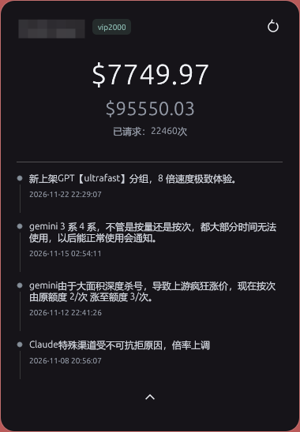

# docode-monitor

Rust + egui 编写的 DoCode 桌面余额与公告组件，默认服务地址为 `https://docode.cc`。



## 功能

1. 支持账号密码登录，登录后的凭证在本地加密存储。下次打开程序自动登录。
2. 可以查看自己的用户组、用户名、余额、已使用额度、总请求次数以及站内公告
3. 支持悬浮在所有界面之前，也可以固定到桌面。
4. 点击右上角的按钮可以更新数据

# 编译

确保你的rust的edition是2024，且版本不低于1.90。

```
cargo build --release
```

运行以上命令即可编译release版本。

# AD

低价AI中转站，就选Docode。

国内外主流模型，一应俱全。

速度顶流，思考不降智。

充的越多，用的越省。

站长和管理员亲切服务，倍感温馨。

找中转，上Docode。

立刻访问：https://docode.cc/

# 许可证

MIT
